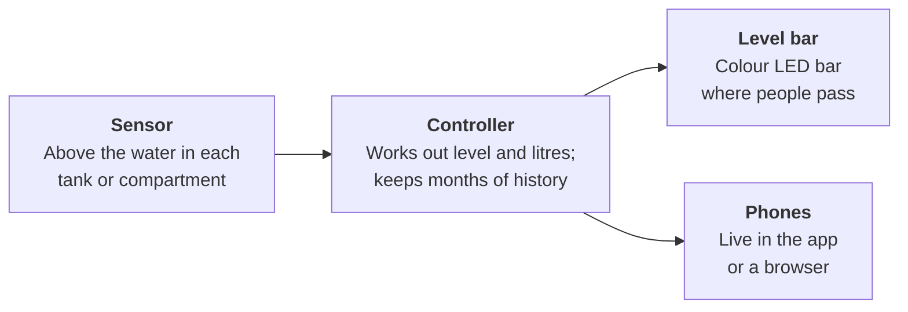
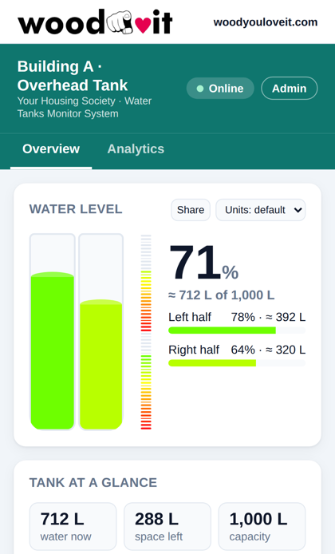
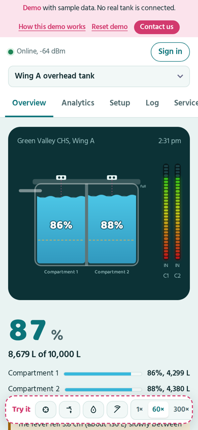
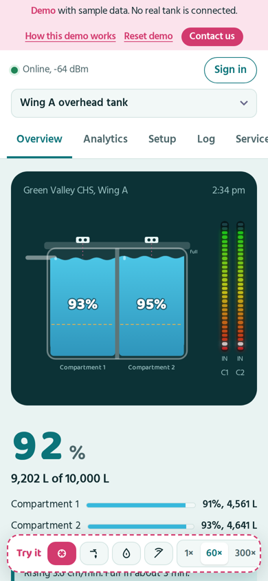
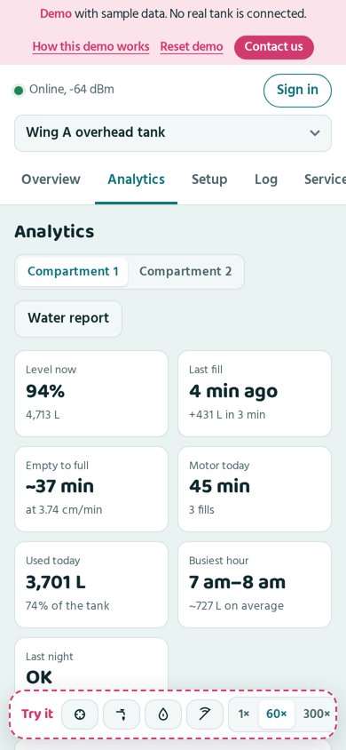
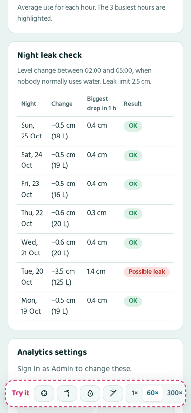
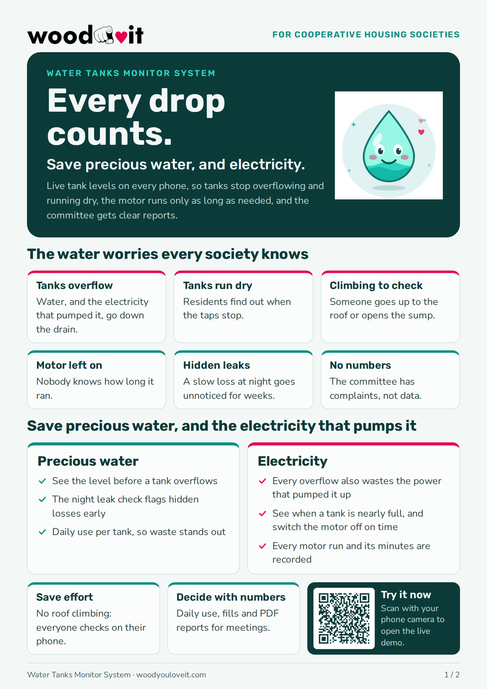
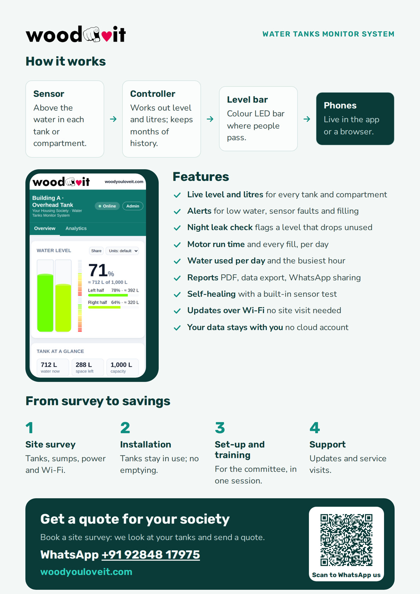

<p align="center">
  
</p>

<h1 align="center">Water Tanks Monitor System: Demo app</h1>

<p align="center">
  <br>
  <b>Every drop counts.</b> Save precious water, and electricity.<br>
  A branded Android app that shows housing societies how the Water Tanks Monitor works, using sample data.
</p>

<p align="center">
  
  
  
  
</p>

<p align="center"><b><a href="https://chanchalsakardeqh.github.io/WATER-TANK-MANAGEMENT-SYSTEM-PRE-SALE-DEMO/">▶ Try the live demo</a></b></p>

<table align="center">
  <tr>
    <td align="center"><br><b>Scan to try the live demo</b></td>
    <td align="center"><br><b>Scan to WhatsApp us</b></td>
  </tr>
</table>

---

## Contents

- [About the Water Tanks Monitor System](#about-the-water-tanks-monitor-system)
- [How it works](#how-it-works)
- [Features](#features)
- [From survey to savings](#from-survey-to-savings)
- [The demo app](#the-demo-app)
- [Screenshots](#screenshots)
- [Building on Windows](#building-on-windows)
- [Project layout](#project-layout)
- [QR codes and print kit](#qr-codes-and-print-kit)
- [Brochure](#brochure)
- [Get a quote](#get-a-quote)

## About the Water Tanks Monitor System

Live tank levels on every phone, so tanks stop overflowing and running dry, the motor runs only as long as needed,
and the committee gets clear reports.

### The water worries every society knows

| Problem | What happens today |
|---|---|
| **Tanks overflow** | Water, and the electricity that pumped it, go down the drain. |
| **Tanks run dry** | Residents find out when the taps stop. |
| **Climbing to check** | Someone goes up to the roof or opens the sump. |
| **Motor left on** | Nobody knows how long it ran. |
| **Hidden leaks** | A slow loss at night goes unnoticed for weeks. |
| **No numbers** | The committee has complaints, not data. |

### Save precious water, and the electricity that pumps it

| 💧 Precious water | ⚡ Electricity |
|---|---|
| See the level before a tank overflows | Every overflow also wastes the power that pumped it up |
| The night leak check flags hidden losses early | See when a tank is nearly full, and switch the motor off on time |
| Daily use per tank, so waste stands out | Every motor run and its minutes are recorded |

- **Save effort:** no roof climbing, everyone checks on their phone.
- **Decide with numbers:** daily use, fills and PDF reports for meetings.

## How it works



<p align="center">
  
</p>

## Features

| Feature | Details |
|---|---|
| **Live level and litres** | For every tank and compartment |
| **Alerts** | Low water, sensor faults and filling |
| **Night leak check** | Flags a level that drops while nobody is using water |
| **Motor run time** | Every fill, per day |
| **Water used per day** | And the busiest hour |
| **Reports** | PDF, data export, WhatsApp sharing |
| **Self-healing** | With a built-in sensor test |
| **Updates over Wi-Fi** | No site visit needed |
| **Your data stays with you** | No cloud account |

## From survey to savings

1. **Site survey:** tanks, sumps, power and Wi-Fi.
2. **Installation:** tanks stay in use; no emptying.
3. **Set-up and training:** for the committee, in one session.
4. **Support:** updates and service visits.

## The demo app

This repository is the **WTMS Demo** Android app. It runs the full dashboard with three sample tanks, completely offline
from the app itself: no website, hosting or tank device is needed. Committees can try every feature before a site survey.

| Screen | What it does |
|---|---|
| Start-up | Teal splash with the save-water drop, then the demo |
| Demo | The full dashboard: Overview, Analytics, Setup, Log and Service. The **Try it** bar switches the motor on, opens a tap, starts a leak or disconnects a sensor, and the dashboard reacts like a real tank |
| Contact us | A form for the society's details. **Send on WhatsApp** opens WhatsApp with everything filled in. **Share another way** offers email, SMS and other apps |
| Water report | "Print or save as PDF" in Analytics opens Android's print screen |
| About | Version, what the product does, woodyouloveit.com |

**Sample tanks**

| Tank | Shows |
|---|---|
| Wing A overhead tank | Two compartments, each with its own sensor and LED bar, and a possible leak last night |
| Home loft tank | A 500 L loft tank whose calibration Smart calibration can correct |
| Underground sump | A 40,000 L sump with a single night-time drop that the leak check recognises as water use |

**Demo sign-ins:** Admin password `demo-admin` (settings and calibration), Service key `demo-service` (firmware update over Wi-Fi).

### Contact us form

| Section | Fields |
|---|---|
| Your society | Society name, address, city or area, PIN code |
| Point of contact | Contact person, role in the society, mobile, email, best time to call |
| Buildings and tanks | Buildings or wings, overhead tanks, underground sumps, average flats per building (the app shows the total flats) |
| Anything else | Message, and consent to be contacted |

Mobile (10-digit Indian number), PIN code, email and counts are checked before sending. A half-filled form is kept on
the phone until it's sent or cleared. Nothing is stored online by the app.

To change where enquiries go, edit `contact_whatsapp` and `contact_whatsapp_display` in
`android/app/src/main/res/values/strings.xml`.

The app ID is `com.woodyouloveit.wtms.demo`, so it installs next to the real Water Tanks Monitor app.

## Screenshots

| Overview | Filling | Analytics | Night leak check |
|:---:|:---:|:---:|:---:|
|  |  |  |  |

## Building on Windows

The app uses the same self-setting-up build script as the Water Tanks Monitor app.

1. Put this folder next to the Water Tanks Monitor project, for example `D:\Android\Projects\WTMS-DEMO-APP`.
2. Double-click **`build-android.bat`**. The first time, it copies `tools\build-android.ps1` from the Water Tanks Monitor
   project and adapts it for the demo (app ID, file names, titles). Run `tools\get-build-script.bat` again whenever you
   update that script.
3. Choose **2** for a debug build installed on your phone, or build a release:

```bat
build-android.bat -Task Debug -Install -Launch
build-android.bat -Task Release -VersionName 1.0.0 -VersionCode 1
```

| Output | Location |
|---|---|
| APK and AAB | `release\android\<version>\woodyouloveit-wtms-demo-<version>-release.apk` and `.aab` |
| Signing key | Same as the real app: `%USERPROFILE%\.woodyouloveit\wtms-release.jks` |
| Tools | Java, the Android SDK and Gradle 8.14.3, shared with your other projects in `D:\Android` |

The `android\` folder also opens directly in Android Studio.

## Project layout

```
build-android.bat                  menu and build launcher
tools/get-build-script.ps1         copies and adapts the Water Tanks Monitor build script
docs/                              images used in this README
qr/                                QR codes (SVG and PNG) for print and the web
print/                             QR print kit: poster, flyers, stickers, visiting cards
tools/make-qr.py                   remakes the QR codes if the number or web address changes
android/
  app/src/main/assets/demo/        the demo page (index.html) and its fonts, bundled for offline use
  app/src/main/java/com/woodyouloveit/wtms/demo/
    MainActivity.kt                branded toolbar, the demo in a WebView, printing, back button
    DemoBridge.kt                  window.WTMSDemo: Contact us and printing from inside the demo
    ContactActivity.kt             Contact us form, WhatsApp and sharing
    Enquiry.kt                     form fields, checks, message text, saved draft
  app/src/main/res/                colours, splash, launcher icon, form layout, texts
```

## QR codes and print kit

Every printed piece has a QR code, so people can contact us with one scan. The WhatsApp codes open a chat to
+91 92848 17975 with the message already typed, ending with where it was scanned, for example
*"Hi, please send a quote for the Water Tanks Monitor. (Ref: Notice board)"*. Each enquiry tells you which place works best.

| QR code | Opens | Where it's used | Smallest print size |
|---|---|---|---|
| [`whatsapp-brochure`](qr/whatsapp-brochure.svg) | WhatsApp chat, *Ref: Brochure* | Society brochure, back page | 25 mm |
| [`whatsapp-poster`](qr/whatsapp-poster.svg) | WhatsApp chat, *Ref: Notice board* | A4 notice-board poster | 25 mm |
| [`whatsapp-flyer`](qr/whatsapp-flyer.svg) | WhatsApp chat, *Ref: Flyer* | A6 flyers, letterbox drops | 25 mm |
| [`whatsapp-sticker`](qr/whatsapp-sticker.svg) | WhatsApp chat, *Ref: Sticker* | Lift, pump room, tank room, meter room | 25 mm |
| [`whatsapp-card`](qr/whatsapp-card.svg) | WhatsApp chat, *Ref: Visiting card* | Visiting cards | 25 mm |
| [`whatsapp-website`](qr/whatsapp-website.svg) | WhatsApp chat, *Ref: Website* | Live demo page on computers and projectors, this README | 25 mm |
| [`live-demo`](qr/live-demo.svg) | The live demo | Brochure front, poster, flyers, slides | 20 mm |
| [`contact-form`](qr/contact-form.svg) | The live demo's Contact us form | Anywhere society details should be filled in | 20 mm |

Each code is in [`qr/`](qr/) as **SVG** (vector, for print shops and design tools) and **PNG** (1200 px, for Word, slides
and WhatsApp status). See [`qr/README.md`](qr/README.md) for printing tips.

**Print kit:** [Water Tanks Monitor – QR print kit (A4).pdf](print/Water%20Tanks%20Monitor%20%E2%80%93%20QR%20print%20kit%20%28A4%29.pdf) has four ready-to-print A4 pages:

| Page | What it is | Print on |
|---|---|---|
| 1 | Notice-board poster with an 82 mm WhatsApp QR and a live demo QR | A4 paper or card |
| 2 | 4 × A6 flyers with cut lines | A4 paper |
| 3 | 12 stickers, 62 × 66 mm, with cut lines | A4 sticker paper |
| 4 | 10 visiting cards, 85 × 55 mm, with cut lines | 300 gsm card |

Print at **100 % (actual size)**, never "fit to page", and test-scan one printed copy before a large print run.

**Changing the number or the web address:** edit `NUMBER` or `DEMO_URL` at the top of `tools/make-qr.py`, then run
`pip install segno` and `python tools/make-qr.py`. All the codes in `qr/` are remade; reprint the pieces that use them.

## Brochure

The two-page A4 society brochure, for printing or sharing with committees: [download the PDF](Water%20Tanks%20Monitor%20System%20%E2%80%93%20Society%20Brochure%20%28A4%29.pdf).
The front has a QR code for the live demo, and the back has a QR code that opens WhatsApp for a quote.

| Front | Back |
|:---:|:---:|
| <a href="docs/brochure-front.png"></a> | <a href="docs/brochure-back.png"></a> |

## Get a quote

**Get a quote for your society.** Book a site survey: we look at your tanks and send a quote.


- WhatsApp: [+91 92848 17975](https://wa.me/919284817975)
- Live demo: [https://chanchalsakardeqh.github.io/WATER-TANK-MANAGEMENT-SYSTEM-PRE-SALE-DEMO](https://chanchalsakardeqh.github.io/WATER-TANK-MANAGEMENT-SYSTEM-PRE-SALE-DEMO/)
- Website: [woodyouloveit.com](https://woodyouloveit.com)

---

<sub>Fonts: Baloo 2 and Hind, SIL Open Font License (licence files in `android/app/src/main/assets/demo/fonts`).
© 2026 woodyouloveit.com</sub>
